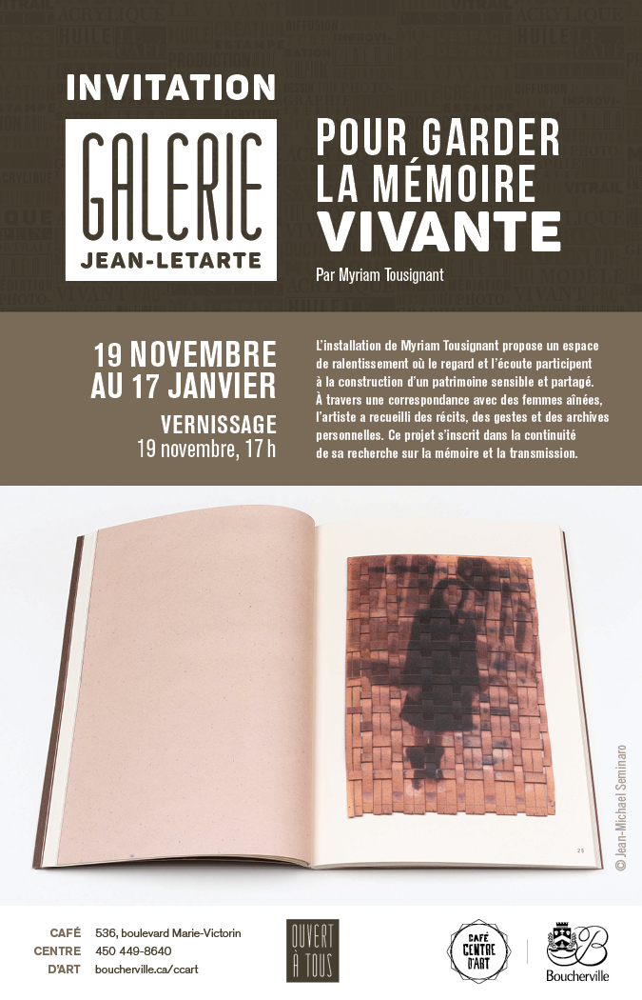

**Myriam Tousignant** — Installation, livre d'artiste, arts imprimés et création sonore.

**Du 19 novembre 2026 au 17 janvier 2027**  
Galerie Jean-Letarte, Café centre d'art  
536, boulevard Marie-Victorin, Boucherville (Québec)  
Entrée gratuite

**Vernissage :** 19 novembre 2026 à 17 h  
**Visite commentée :** 8 décembre 2026 à 13 h 30

[Consulter la page des galeries de la Ville de Boucherville](https://www.boucherville.ca/culture/lieux-culturels/galeries/)

Pour garder la mémoire vivante est une installation qui propose un espace de ralentissement où le regard et l'écoute participent à la construction d'un patrimoine sensible et partagé. Pensée autour du livre comme espace habitable, l'exposition invite le public à parcourir un univers où se rencontrent récits, gestes, images et archives personnelles.

Au cœur de cette proposition, le livre d'artiste *Récit choral* devient le fil conducteur d'un parcours qui prolonge une recherche amorcée à travers une correspondance avec des femmes de différentes générations. Les fragments de mémoire recueillis au fil de ces échanges prennent forme dans une installation où le livre dépasse sa fonction d'objet pour devenir un espace de rencontre, de contemplation et de transmission.

À travers les arts imprimés, les cyanotypes, la photographie et la création sonore, l'artiste explore les liens entre mémoire individuelle et mémoire collective. Les images et les récits se répondent, évoquant les traces laissées par les générations précédentes et la manière dont elles continuent d'habiter le présent.

Pour garder la mémoire vivante invite ainsi le public à ralentir, à regarder, à écouter et à habiter un espace où les souvenirs se déploient dans une expérience sensible et poétique.

### À propos de l'artiste

Myriam Tousignant est une artiste multidisciplinaire dont la pratique privilégie les arts imprimés et la poésie, et s'ancre dans la mémoire collective, les récits intimes et la transmission intergénérationnelle. Elle s'intéresse particulièrement aux archives personnelles, aux voix marginales et aux formes participatives de création qui favorisent l'émergence de récits pluriels.

_Crédit photo : Jean-Michael Seminaro_
